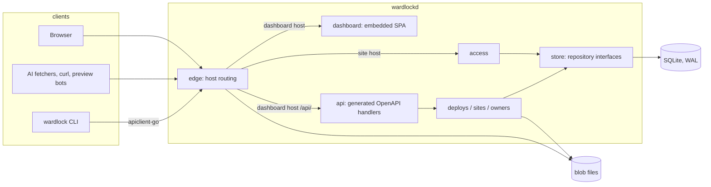
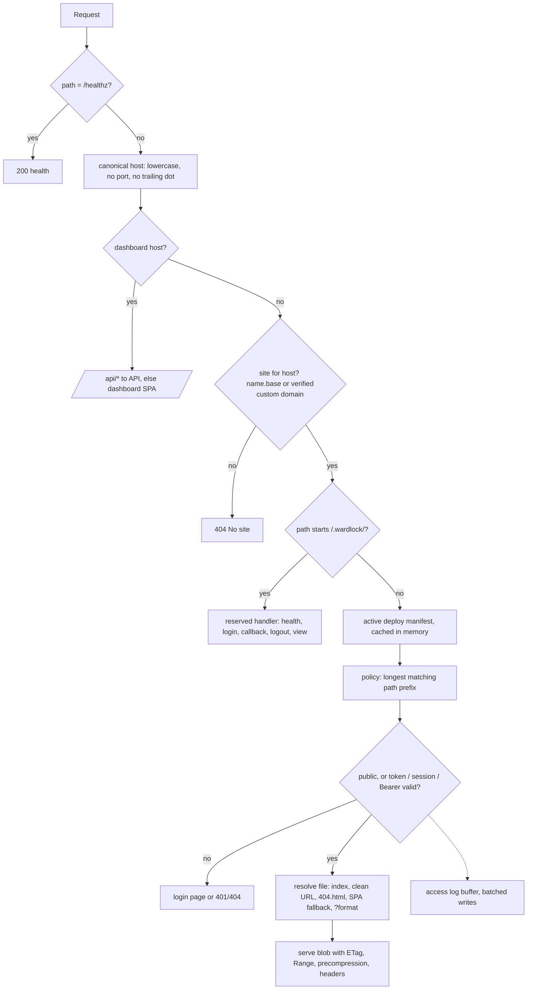
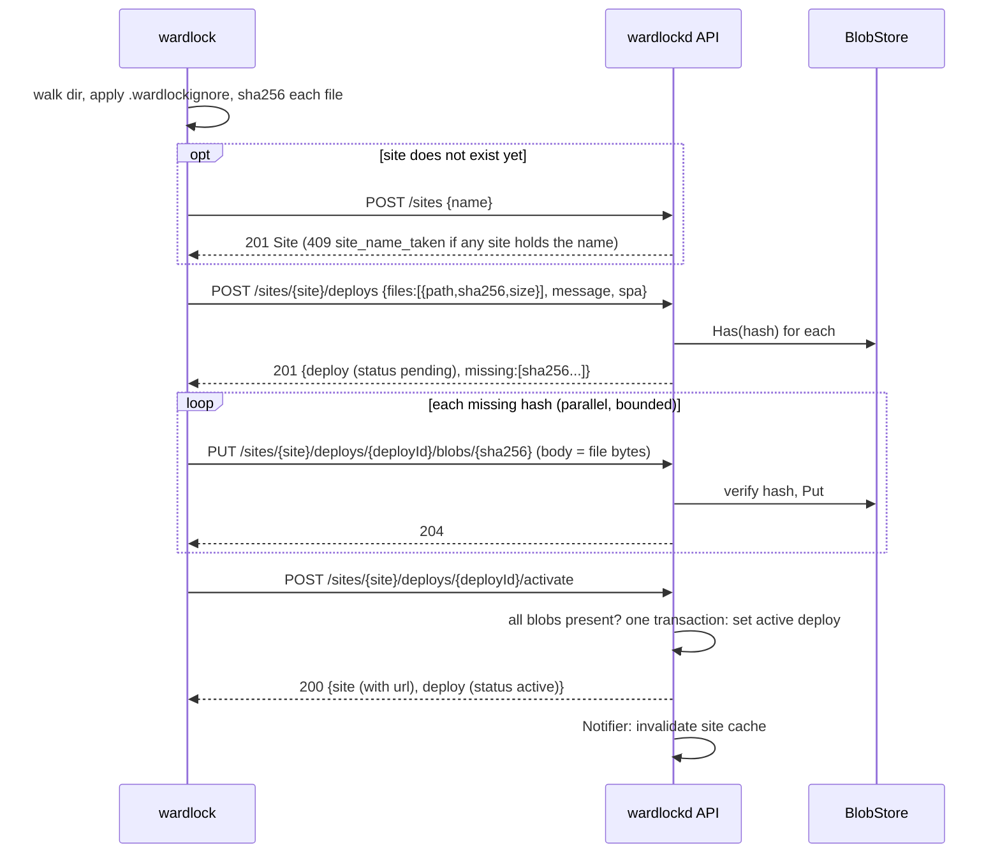
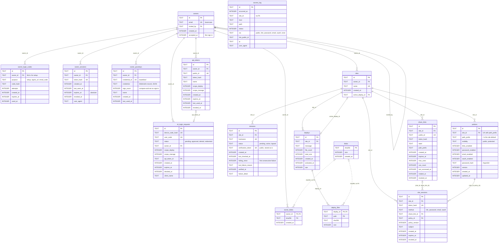
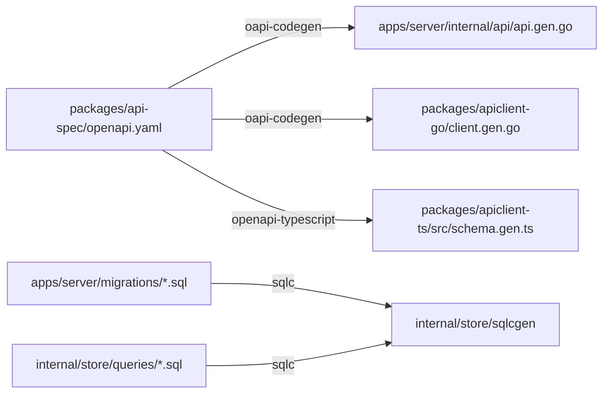

# Architecture

Wardlock is one Go process, `wardlockd`, with an embedded dashboard and a SQLite database, plus a Go CLI that talks to it over the HTTP API. This document records the decisions later items build on. Sections marked with a roadmap ID describe planned behaviour; the rest is built.



## Processes and binaries

- `wardlockd serve` runs everything: the edge on `WARDLOCK_HTTP_ADDR` (and `WARDLOCK_HTTPS_ADDR` in automatic TLS mode), the owner API and the dashboard. Configuration is environment variables only (`.env.example` lists every one). `wardlockd admin create` and `wardlockd gc` run one task against the same data directory.
- `wardlock` (CLI) is a separate Go module with no server code; it uses `wardlock.nz/apiclient`.
- `cmd/wardlockd/serve.go` is the only place that wires packages together. It mounts the API under `/api/` on the dashboard host and hands the edge the resulting `http.Handler`, so the edge never imports the API.

## Request flow through the edge



F0.1 implements health, host routing, the dashboard and `/.wardlock/health`; C1.3 serves deploys. The edge reads sites through its own `SiteSource` interface (host to site, active manifest), opens file bodies through a `BlobOpener` and subscribes to an `Invalidator`; `cmd/wardlockd` adapts `store` and the deploys `BlobStore` and `Notifier` to them, so the edge imports neither `store` nor `deploys`. It caches each served host's site and active manifest in memory (hits only, so a new site is found on its first request) and drops a site's hosts when the `Notifier` (in-process in v1) reports a change to it; a cached small file is served without touching the database. Concurrent misses on one host share a single load. The cache has no LRU or size cap: it holds one entry per served host and one manifest per served site, so it is bounded by the number of sites and active custom domains times the deploy file limit (20,000 files by default). Anything that changes what a host serves must call the site's `Notifier`: activation, rollback, teardown and site deletion (C1.2) do, and C1.9 must notify when a custom domain is added, verified, lapses or is removed, or the edge keeps serving the old mapping. The access step (A2.1) asks the edge's `Access` interface, satisfied by `*access.Service`, for a decision on plain values: site ID, cleaned path, the `__Host-wardlock_site` cookie value and whether the client accepts HTML. The decision (`Allow`, `Login` or `Unauthorized`, plus `Protected`, the governing policy, `Via` for the access log and whether to clear the cookie) is the one place that switches `Cache-Control` to `private` and adds the protected-site headers. When the file that answers comes from another path (`404.html`, the SPA index, a clean URL's `page.html`), the edge asks again for that file's path and answers a plain 404 if it is not allowed, so a public path never leaks a protected fallback. `/.wardlock/*` is answered before any decision. Each site request that gets an access decision is reported to the access log once its response is written (see Storage seam).

### Policy evaluation (A2.1)

`access.Service` keeps each site's policies in memory, ordered by prefix, and drops a site's entry when the `Notifier` reports a change; the policy API notifies on every set and delete, so a change applies on the next request and a public request never touches the database. A site with no stored default (any site its owner has not configured, including those created before A2.1) gets the public default inserted on first load (`INSERT … ON CONFLICT DO NOTHING`), so protection is opt-in. `edge.New` refuses a `Config` without `Access` (`ErrNoAccess`): there is no implicit allow-all, so a wiring mistake cannot serve protected sites, and `TestServe` checks through `serve()` that a protected site answers 401. The governing policy is the longest prefix matching the path. A protected policy allows a request only with a site session cookie that verifies (HMAC-SHA-256 under a purpose-separated use of the server key, compared in constant time), names this site, is unexpired, is bound to the governing policy's ID and current version, and whose stored row (looked up by the HMAC of its token) is unrevoked, unexpired and created by a method the policy enables. So a version bump or a deleted policy ends sessions without touching their rows. `IssueSession` and `EndSession` are the primitives the A2.2 to A2.5 methods and `/.wardlock/logout` use; `store.Policies.Set` changes a policy and bumps its version in one transaction.

## Deploy upload protocol (C1.2)

The operations are in `packages/api-spec/openapi.yaml` (tag `deploys`); paths below are relative to `/api/v0`.



The server verifies each uploaded blob's SHA-256 before storing it (`400 hash_mismatch`) and accepts only hashes in that deploy's manifest (`400 unexpected_blob`); re-uploading a blob it already holds succeeds, so retries are safe.

Missing hashes are computed **per owner**. A blob counts as held for an owner only when that owner has uploaded it with a verified hash (a row in `owner_blobs`) and it is still in the BlobStore. Uploading a blob another owner already stored still reads and verifies the whole body, then records the claim without rewriting the file. Activation requires the same for every hash in the manifest, re-checked inside its transaction. So neither the `missing` list, `uploadDeployBlob` nor `blobs_missing` ever tells one owner whether another owner's content is on the server; the cost is that two owners publishing the same file each upload it once. Activation rejects a deploy with blobs still missing (`409 blobs_missing`) and is a single transaction that moves the site's `active_deploy_id`. Rollback (`POST /sites/{site}/rollback {deployId?}`) is the same transaction pointed at an earlier activated deploy, the previous one by default, with no upload. Path and limit violations are rejected when the deploy is created (`400 invalid_path` naming the path, `413 limit_exceeded`), as is one hash listed with two sizes (`400 invalid_manifest`). Paths are stored byte for byte, with no Unicode normalisation; the CLI (C1.5) sends them in NFC. Renditions (A2.6) are generated between upload completion and activation and stored as blobs referenced from the manifest.

## Storage layout

```text
$WARDLOCK_DATA_DIR/
  wardlock.db (+ -wal, -shm)   SQLite: all metadata
  blobs/sha256/ab/cdef…        content-addressed file bodies (C1.2)
  certs/                       certmagic storage (C1.4)
```

Blobs are written to a temporary file in the same directory, fsynced, then renamed into place, so a blob either exists completely or not at all. `WARDLOCK_BLOB_DIR` moves `blobs/` elsewhere. Garbage collection (C1.8, `deploys.GC` over the instance-wide `store.GC` repository) runs at start and every `WARDLOCK_GC_INTERVAL_MINUTES` inside `serve`, and once with `wardlockd gc`, which is safe beside a running server because SQLite serialises their write transactions. A run has three steps, each paging through the store 500 rows at a time. (1) It deletes deploys with at least `WARDLOCK_DEPLOY_HISTORY` newer deploys on their site, except the site's active deploy and pending deploys created within the grace period (`WARDLOCK_GC_GRACE_HOURS`); the delete re-checks both in its own statement, so a concurrent rollback or activation wins, and the manifest cascades. (2) It deletes blobs no `deploy_files` row lists whose `blobs.created_at` and every `owner_blobs.created_at` are older than the grace period. Each blob is one transaction that re-checks that test, deletes the blob's `owner_blobs` rows and its `blobs` row, and removes the file before committing; a failed removal rolls the rows back. Because transactions begin `IMMEDIATE`, a deploy created or an upload recorded for the same hash is ordered either before the re-check (the blob is kept) or after the file is gone (no owner still holds it, so the deploy lists it as missing and the owner uploads it again); a blob a deploy needs for activation is therefore never lost. A Postgres backend must give these transactions the same ordering, for example with a per-hash advisory lock. (3) It walks the blob directory for files older than the grace period with no `blobs` row, left by a crash between storing and recording an upload, and for abandoned `.upload-*` temporary files, and removes them, the former in a transaction that re-checks the row. The deploy service also treats a claimed hash whose file is missing as missing, so a crash between the two, or an upload whose file step (3) removed before the record landed, leaves the owner asked to upload it again. Claims to blobs that are kept are never touched, so one owner's deploys cannot change what another owner is asked to upload. Each run logs `garbage collection finished` with `deploys_pruned`, `blobs_deleted`, `files_deleted`, `bytes_freed` and `duration`.

## Database

- SQLite through `modernc.org/sqlite` (pure Go, no CGO, so cross-compiling stays trivial). WAL mode, `foreign_keys=ON`, `busy_timeout=5000`, `synchronous=NORMAL`, transactions begin `IMMEDIATE`.
- **Migrations:** a minimal in-house runner (`internal/store/migrate.go`) applies embedded `apps/server/migrations/NNNN_name.sql` files in order, each in one transaction, recording them in `schema_migrations`. Forward only; files are never edited after merge. Versions must be contiguous. The server refuses to start against a database newer than itself (`ErrDatabaseNewer`). We chose this over goose because the requirement is small (plain ordered SQL), it adds no dependency, and it keeps the SQL identical for a future Postgres runner. Revisit if we need down migrations or Go-coded migrations.
- **Queries:** `sqlc` generates typed Go from `internal/store/queries/*.sql` into `internal/store/sqlcgen` (committed). Queries use `sqlc.arg(name)` parameters. There is no ORM.
- **Repository interfaces:** `store` declares one interface per area (`Owners`, `Sessions`, `APITokens`, `Sites`, `Domains`, `Deploys`, `Policies`, `Links`, `AccessLog`; F0.3 onwards) and implements them with sqlc. Domain packages accept the interfaces only; depguard forbids `database/sql` and `sqlcgen` there. Each interface has a contract test suite run against SQLite through `storetest.New`.

### Data model (F0.3)

Migration `0002_core_schema.sql` creates every table below; `0003_deploy_spa_and_owner_blobs.sql` (C1.2) moves the SPA fallback flag from sites to deploys, adds `owner_blobs` and the optional columns the API contract exposes (`owner_sessions.user_agent`, `domains.verified_at` and `failure_detail`, `cli_login_requests.client_name`); `0004_owner_passkeys.sql` (C1.6) adds `owner_passkeys`. `internal/store/schema_test.go` checks that this diagram lists exactly the schema's tables, columns, types, primary keys and foreign keys, so update both together. Solid lines are foreign keys; the dotted line is a reference by value with no foreign key.



Columns follow the portable-SQL rules: text IDs (UUIDv7, `store.NewID`) generated in Go, timestamps as UTC Unix milliseconds in `INTEGER` (Postgres `BIGINT`), booleans as `INTEGER` with `CHECK (x IN (0, 1))`, upserts with `ON CONFLICT … DO UPDATE` (or `DO NOTHING`). Token, session and code columns hold only HMAC hashes, and the policy password only an Argon2id hash; the domain verification token is stored as is because it is published in DNS. `access_log` has no foreign keys, so it can later move to a separate store and outlive the sites it mentions. A site session's link and policy are composite foreign keys `(site_id, share_link_id)` and `(site_id, policy_id)` onto `UNIQUE (site_id, id)` in `share_links` and `policies`, so a session can never name another site's link or policy. Deleting a site cascades to its domains, deploys and their manifests, policies, share links and site sessions; the active deploy cannot be deleted on its own.

Names chosen for C1.1: one-time owner credentials live in `owner_login_codes` (`purpose` is `setup` for the first-start setup URL with no owner, `signin_url` for the `admin create` or invite sign-in URL, `email_code` for the 6-digit code). An invite is an `owners` row with `invited_by` set and `accepted_at` NULL plus a `signin_url` code; `accepted_at` is set on first sign-in. CLI login (C1.7) is `cli_login_requests`: the CLI polls with a hashed device code and the API token is minted only when an approved request is redeemed. `client_name` holds what the CLI called itself until approval, then the name of the token it will receive. Poll intervals and API-token failure limits are kept in memory (`internal/owners`), like the sign-in limits; a restart only resets them early.

**Contract tests.** `storetest.RunContract(t, open)` runs one suite per repository interface; each case gets a fresh database from `open`. SQLite runs it in `internal/store/contract_test.go`; a future backend passes its own opener. Every new repository method adds cases to its interface's suite in `internal/store/storetest/<area>_contract.go`. F0.3 implements only the methods those suites need to exercise the constraints; feature items add the rest in their own `queries/<area>.sql`.

### Storage seam

Wardlock scales up on one machine first: the edge caches manifests in memory, deploys are rare writes, and SQLite in WAL mode handles that easily. Running several server instances would need Postgres, shared blob storage (S3), shared certificate storage and shared rate-limit state, so the seam covers all four:

| Concern            | Interface                                    | v1 implementation      | Later                                     |
| ------------------ | -------------------------------------------- | ---------------------- | ----------------------------------------- |
| Metadata           | `store.Sites`, `Deploys`, `Links`, …         | SQLite + sqlc          | Postgres, passing the same contract tests |
| File bodies        | `BlobStore` (`Has`, `Put`, `Open`, `Delete`) | filesystem             | S3-compatible                             |
| Certificates       | certmagic `Storage` from config              | certmagic file storage | shared storage                            |
| Rate limits        | `Limiter`                                    | in-memory              | shared store                              |
| Cache invalidation | `Notifier`                                   | in-process             | Postgres `LISTEN/NOTIFY` or similar       |

Access-log writes are the only per-request writes. They go into an in-memory buffer flushed in batches (every second or 500 entries) off the request path, so serving never waits on the database; a full buffer drops entries and counts the drops rather than blocking.

The pipeline (A2.8) is `internal/access/accesslog`. The edge wraps the response writer of each request that reaches the access decision to capture the status, then hands its `AccessRecorder` a plain `edge.AccessRecord` (cleaned path without query, `Via` and link public ID from the request's `access.Decision` (not the second decision a fallback file gets), the client IP from `RemoteAddr` as the trusted-proxy middleware left it, User-Agent); `cmd/wardlockd` adapts it to `accesslog.Writer.Record` through `accesslog.ParseVia`, so the edge never depends on the writer or `store`. `Record` runs on the request goroutine and does only cheap work: it truncates the IP, drops any query or fragment, reduces any `wl_<public id>_<secret>` in the path or User-Agent to its public ID, caps lengths, normalises `via` (an unknown value, or `link` without a public ID, becomes `none`; a status outside 100 to 599 is dropped and counted) so no entry can fail its batch's checks, assigns an ID and makes a non-blocking send into a bounded channel (`WARDLOCK_ACCESS_LOG_BUFFER`); when the channel is full it counts a drop. One writer goroutine appends batches in a transaction through `store.AccessLog`, with a 10-second bound per write; a failed batch is logged and counted as dropped, not retried, so it cannot back up the buffer. Drops are logged from whichever goroutine sees them, at most every 10 seconds, because the writer goroutine may be the one stuck. `Close`, called after the HTTP server has shut down and before the database closes, stops accepting entries, drains the channel and writes the rest within `platform.ShutdownTimeout`. A second goroutine prunes entries older than the retention period at start and hourly, in chunks of 1,000 rows (`DELETE … WHERE id IN (SELECT … LIMIT …)`), each within the 10-second bound, until none are left or the writer closes, so a large backlog never holds the write lock for long or delays batches. `Close` relies on the store honouring context cancellation to return at its deadline. Pruning has no index on `occurred_at` alone, so each chunk scans; adding one needs a migration (follow-up). The edge records a handler panic before any status as 500 and re-raises it. `store.AccessLog` lists a site's entries, or one link's on a site, newest first with an `(occurred_at, id)` cursor and a limit clamped to 1 to 1,000, joined to `sites` on the owner, so a foreign or deleted site lists nothing. A Postgres driver, S3 client and multi-instance coordination are out of scope for v1.

## TLS modes (C1.4)

`WARDLOCK_TLS_MODE` selects the mode; unset, it is `local` when the base domain and dashboard host are `localhost` or `*.localhost` and `proxy` otherwise, so `auto` is always an explicit choice. DEPLOYMENT "TLS" lists the variables.

| Mode                     | When                                           | Behaviour                                                                                                                                                                                                                                                                                                              |
| ------------------------ | ---------------------------------------------- | ---------------------------------------------------------------------------------------------------------------------------------------------------------------------------------------------------------------------------------------------------------------------------------------------------------------------- |
| Automatic (`auto`)       | Public server with ports 80/443                | certmagic obtains a wildcard `*.<base domain>` certificate through DNS-01 (Cloudflare or deSEC through `libdns`), which covers the auth origin, plus the dashboard host (DNS-01 inside the base domain's zone, HTTP-01/TLS-ALPN-01 outside it); on-demand TLS for active custom domains only. HTTP redirects to HTTPS. |
| Behind a proxy (`proxy`) | Caddy, nginx or a load balancer terminates TLS | Plain HTTP only; trusts `X-Forwarded-*` from `WARDLOCK_TRUSTED_PROXIES` only. The proxy asks `/.wardlock/tls-ask` before issuing a custom-domain certificate (C1.9).                                                                                                                                                   |
| Local (`local`)          | `*.localhost` development                      | Plain HTTP. Browsers treat `http://*.localhost` as a secure context, so `Secure` and `__Host-` cookies still work.                                                                                                                                                                                                     |

`internal/tls` holds the certmagic `Manager`, the on-demand decision (`OnDemand`, backed by the `Domains` repository's active-hostname lookup through a one-method interface), the redirect and the trusted-proxy middleware. Three certmagic configurations share one certificate cache: one solves DNS-01 for names in the base domain's zone; one solves HTTP-01/TLS-ALPN-01 for a dashboard host outside that zone; and one obtains on-demand certificates the same way and answers every handshake (the dashboard cannot share it, because certmagic obtains a config's managed names only on demand once it has on-demand issuance). certmagic keeps serving a cached on-demand certificate after the decision would deny it, until renewal or restart, so C1.9 must evict a custom domain's certificate from the cache and storage when the domain lapses or is removed. Until then the edge still answers the host with a 404. Storage is a certmagic `Storage` passed in by `cmd/wardlockd` (file storage in `<data dir>/certs` in v1). The trusted-proxy middleware runs before everything in every mode: from a trusted peer it rewrites `RemoteAddr` to the client from `X-Forwarded-For` (right to left, skipping trusted hops); from any other peer it strips the forwarding headers. The edge, API and rate limits therefore read the client from `RemoteAddr` and need no knowledge of proxies. The connecting peer, and whether it is a trusted proxy, stays in the request context (`tls.PeerFrom`) for checks that must identify the proxy itself, such as `/.wardlock/tls-ask` (C1.9).

## Auth origin (A2.5)

OAuth and OIDC providers cannot register wildcard redirect URIs, so every provider redirect goes to `https://auth.<base domain>/callback/<provider>`, served by the edge. It validates `state` and PKCE, checks the allowlist, then creates a single-use, 60-second code bound to the target site and path and redirects to `https://<site>/.wardlock/callback?code=…`. The edge on the site host exchanges the code server-side and sets the host-only site cookie. No cookie is ever set on the base domain.

## Owner API and code generation



- The OpenAPI 3.1 document is the single source of truth. The server implements oapi-codegen's strict interface (`internal/api`); the CLI uses the generated Go client; the dashboard uses `openapi-fetch` typed by `openapi-typescript`. All API paths sit under `/api/v0/` on the dashboard host. The document's description records the conventions every operation follows: the `Error` body (`code`, `message`, optional `target`) and its status codes, the `sessionCookie` and `apiToken` (scopes `deploy`, `manage`) security schemes, UUIDv7 text IDs, Unix-millisecond timestamps, and cursor pagination (`limit`, `cursor`, `{items, nextCursor}`).
- Every operation in the contract is routed from the start. `Server` embeds the generated `Unimplemented` stub (`unimplemented.gen.go`, rendered from `internal/api/templates/`), so an operation answers `501 not_implemented` until its handler lands; a test generated from the same contract proves each one answers 501 rather than 404. The dashboard and CLI expose an operation only once it is built.
- The generated server decodes requests but does not enforce schema constraints (patterns, `additionalProperties`, `minItems` and the like) at runtime, so handlers must validate their input.
- `pnpm codegen` (`scripts/codegen.sh`) regenerates everything and prepends SPDX headers. `pnpm check:codegen` regenerates and fails if any generated file changed, which is how CI catches hand edits and forgotten regeneration.
- Tool versions are pinned in `tools/go.mod` (sqlc, oapi-codegen, golangci-lint, govulncheck) and built into `.local/bin` on first use; `openapi-typescript` and Redocly CLI are pinned in `packages/api-spec/package.json`. `pnpm check:api-spec` lints the contract with Redocly's `recommended-strict` rules plus the rules in `packages/api-spec/lint.redocly.yaml` (every operation has an `operationId`, a 4xx and a default error response, and every body an example).
- The dashboard is built by Vite to `apps/web/dist`, copied by `scripts/embed-dashboard.sh` into `apps/server/internal/dashboard/ui/dist` (gitignored) and embedded with `go:embed`. A server built without it serves `ui/fallback.html`. In `pnpm dev` the server proxies dashboard pages to Vite instead.

## Go workspace

`go.work` lists `apps/server`, `apps/cli` and `packages/apiclient-go` and pins the toolchain (`go1.27.2`). Module paths are vanity paths on `wardlock.nz`. Because that domain does not yet serve `go-import` metadata, the server and CLI `go.mod` files `replace wardlock.nz/apiclient => ../../packages/apiclient-go`: `go.work` covers workspace builds, and the `replace` covers `GOWORK=off` builds and `go mod tidy`. (A `replace` in `go.work` itself is rejected by Go for a module the workspace also uses.) `tools/` is deliberately outside the workspace so linter dependencies never affect product builds.

## Checks

`pnpm check` runs, in order: ESLint and Prettier; the OpenAPI lint (`pnpm check:api-spec`); TypeScript typecheck; Vitest; the Turbo build and `scripts/build-go.sh`; `scripts/check-boundaries.mjs` (SPDX headers, package licences, MIT modules not requiring the server); the codegen drift check; then `scripts/check-go.sh` for each workspace module (gofmt, `go vet`, golangci-lint with depguard boundaries, `go test -race`, govulncheck). Go runs from a script rather than through Turborepo because Go's own build and test caches already make reruns cheap, and wrapping each module in a `package.json` would duplicate them. `pnpm browser:test` runs separately because it needs a browser.
