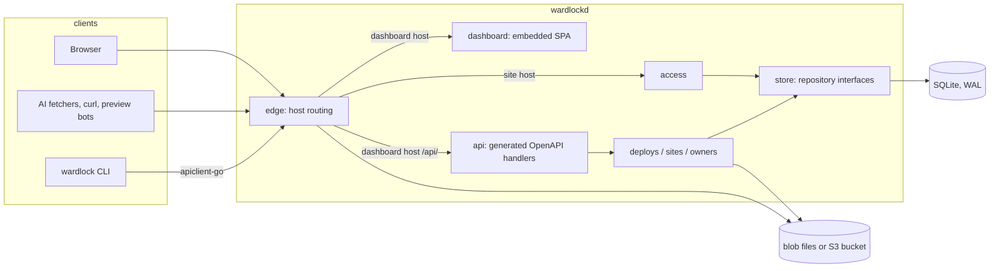
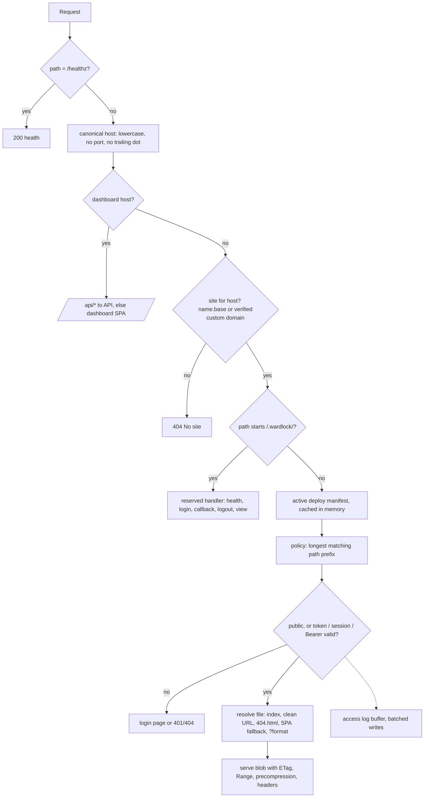
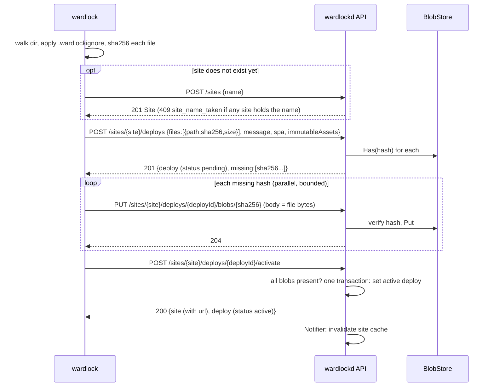
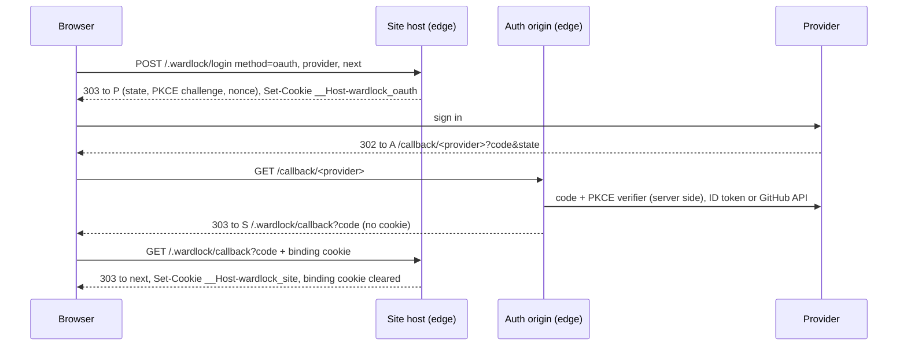
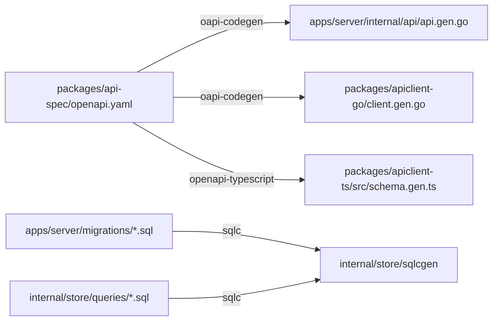

# Architecture

Wardlock is one Go process, `wardlockd`, with an embedded dashboard and a SQLite database, plus a Go CLI that talks to it over the HTTP API. This document records the decisions the code is built on. A roadmap ID next to a section or statement names the item that built it.



## Current boundary

Every v1 item in the foundation, core, access, dashboard and operations areas is built and merged; the open items (C1.12, A2.13 to A2.15, O4.10, O4.13) are listed in [ROADMAP](../ROADMAP.md). Each section below opens with what most readers need and keeps the implementation detail in a collapsed block. The table lists what each built item added and where it is described.

<details>
<summary>What each built item added</summary>

| Item  | Adds                                                                                                                                      | Section                                                                     |
| ----- | ----------------------------------------------------------------------------------------------------------------------------------------- | --------------------------------------------------------------------------- |
| F0.1  | The pnpm, Turborepo and Go workspaces, pinned tools, `pnpm check`, CI, and the edge's health endpoint, host routing and dashboard serving | Processes and binaries, Request flow through the edge, Go workspace, Checks |
| F0.2  | `packages/api-spec/openapi.yaml`, the generated server, Go and TypeScript clients, the `Unimplemented` stub and the codegen drift check   | Owner API and code generation                                               |
| F0.3  | The migration runner, the core schema, sqlc queries, the repository interfaces and their contract tests                                   | Database, Data model                                                        |
| F0.4  | `internal/mail` with its `Mailer` interface, `WARDLOCK_SMTP_URL` and the `dev://` sink                                                    | DEPLOYMENT "SMTP"                                                           |
| C1.1  | Owner bootstrap, email-code sign-in, dashboard sessions, invites and `owner_login_codes`                                                  | Data model                                                                  |
| C1.2  | The deploy API, the filesystem `BlobStore`, per-owner blob claims (`owner_blobs`), activation, rollback and the `Notifier`                | Deploy upload protocol, Storage layout                                      |
| C1.3  | Edge static serving: the site and manifest cache, file resolution and blob serving                                                        | Request flow through the edge                                               |
| C1.4  | `internal/tls`: the three TLS modes, certmagic and the trusted-proxy middleware                                                           | TLS modes                                                                   |
| C1.5  | The CLI's deploy, list, rollback and teardown commands, sending paths in NFC                                                              | Deploy upload protocol                                                      |
| C1.6  | Owner passkeys (`owner_passkeys`)                                                                                                         | Data model                                                                  |
| C1.7  | API tokens and CLI browser login (`cli_login_requests`)                                                                                   | Data model                                                                  |
| C1.8  | Blob garbage collection (`deploys.GC`, `store.GC`, `wardlockd gc`)                                                                        | Storage layout                                                              |
| C1.9  | Custom domains in `internal/sites`, the verification checker, on-demand certificates and `/.wardlock/tls-ask`                             | Custom domains, TLS modes                                                   |
| C1.10 | Long-term caching for hashed assets (`deploys.immutable_assets`, `immutableCacheControl`)                                                 | Request flow through the edge, Data model                                   |
| C1.11 | `deploys.S3BlobStore`, chosen with `WARDLOCK_BLOB_BACKEND=s3`                                                                             | Storage layout                                                              |
| C1.12 | Lazy blob opens, bodyless responses that never open a blob, the S3 upload probe and `deploys.CachingBlobStore`                            | Request flow through the edge, Storage layout                               |
| A2.1  | Policy evaluation in `access.Service`, site session cookie primitives and the edge's access step                                          | Policy evaluation, Request flow through the edge                            |
| A2.2  | Share links, the use-limited interstitial and the shared fixed-window limiter                                                             | Policy evaluation                                                           |
| A2.3  | Password policies and the Argon2id semaphore                                                                                              | Storage seam                                                                |
| A2.4  | Email-code policies (`policy_allowlist`, `visitor_email_codes`)                                                                           | Data model                                                                  |
| A2.5  | OAuth and OIDC through the auth origin and `internal/oauth`                                                                               | Auth origin                                                                 |
| A2.6  | AI-readable renditions (`deploys.Render`, `deploy_renditions`, `?format=`)                                                                | Deploy upload protocol, Request flow through the edge                       |
| A2.7  | The access security review and its fixes                                                                                                  | SECURITY-MODEL                                                              |
| A2.8  | The access log pipeline (`internal/access/accesslog`)                                                                                     | Storage seam                                                                |
| A2.9  | Bounded limiter tables, the count-min overflow sketch and per-network limits                                                              | Policy evaluation                                                           |
| A2.10 | Redaction in the certmagic log adapter and the `dev://` mail warning                                                                      | SECURITY-MODEL "Third-party log output"                                     |
| A2.11 | A distinct error code for the domain-check cooldown                                                                                       | SPEC "Custom domains"                                                       |
| A2.12 | The per-site access log (`listSiteAccessLog`, `access.Service.SiteAccessLog`)                                                             | Storage seam                                                                |
| D3.1  | The dashboard shell, router and owner sign-in screens                                                                                     | Owner API and code generation, SPEC "Dashboard"                             |
| D3.2  | Site list and detail, deploy history, rollback and teardown screens                                                                       | SPEC "Dashboard"                                                            |
| D3.3  | Share link screens and the per-link access log                                                                                            | SPEC "Dashboard"                                                            |
| D3.4  | The policies editor                                                                                                                       | SPEC "Dashboard"                                                            |
| D3.5  | The custom domains section of the site page                                                                                               | SPEC "Dashboard"                                                            |
| D3.6  | "Open site", which opens a protected site through a short-lived share link                                                                | SPEC "Dashboard"                                                            |
| O4.1  | GoReleaser, the install script, the systemd unit, the compose example and the module tag scheme                                           | Go workspace, DEPLOYMENT                                                    |
| O4.2  | The operator listener (`/healthz`, `/readyz`, `/metrics`) and `wardlockd backup`                                                          | Processes and binaries                                                      |
| O4.3  | The documentation site (`docs-site/`), built by `pnpm build`                                                                              | `docs-site/README.md`                                                       |
| O4.5  | Test fixes at their root causes                                                                                                           | (tests only)                                                                |
| O4.8  | depguard rules for every boundary in MODULES                                                                                              | Checks                                                                      |
| O4.9  | CI no longer uploads unused snapshot and docs-site artifacts                                                                              | (CI only)                                                                   |
| O4.11 | The release workflow's publish job, run only on an authorised `v*` tag                                                                    | DEPLOYMENT "Releases and module tags"                                       |
| O4.12 | `deploy/vps/`: one VPS with automatic TLS and R2 blob storage                                                                             | DEPLOYMENT "VPS with automatic TLS and R2 (O4.12)"                          |

O4.4, O4.6 and O4.7 changed documents only (the launch checklist, the alpha documentation refresh and the CLA text).

</details>

## Processes and binaries

- `wardlockd serve` runs everything: the edge on `WARDLOCK_HTTP_ADDR` (and `WARDLOCK_HTTPS_ADDR` in automatic TLS mode), the owner API and the dashboard. Configuration is environment variables only (`.env.example` lists every one).
- `wardlock` (CLI) is a separate Go module with no server code; it uses `wardlock.nz/apiclient`.
- `cmd/wardlockd` is the only package that wires packages together.

<details>
<summary>Implementation detail</summary>

- `wardlockd admin create`, `wardlockd gc` and `wardlockd backup PATH` (an online SQLite backup) run one task against the same data directory, and `wardlockd version` prints the build. With `WARDLOCK_OPERATOR_ADDR` set, `serve` also opens an operator listener for `/healthz`, `/readyz` and `/metrics` (DEPLOYMENT "Health, readiness and metrics").
- `serve.go` mounts the API under `/api/` on the dashboard host and hands the edge the resulting `http.Handler`, so the edge never imports the API.

</details>

## Request flow through the edge

The edge normalises the host, sends the dashboard host to the dashboard and API, and for a site host checks the reserved path, the governing policy and then the file. Every site response that got an access decision is reported to the access log.



F0.1 implements health, host routing, the dashboard and `/.wardlock/health`; C1.3 serves deploys. The edge caches each served host's site and active manifest in memory and drops them when the site's `Notifier` reports a change, so anything that changes what a host serves must call it. The access decision is the one place that switches `Cache-Control` to `private` and adds the protected-site headers, and a fallback file is checked again for its own path.

<details>
<summary>Implementation detail</summary>

- **Interfaces.** The edge reads sites through its own `SiteSource` interface (host to site, active manifest), opens file bodies through a `BlobOpener` and subscribes to an `Invalidator`; `cmd/wardlockd` adapts `store` and the deploys `BlobStore` and `Notifier` to them, so the edge imports neither `store` nor `deploys`.
- **Cache.** It caches each served host's site and active manifest in memory (hits only, so a new site is found on its first request) and drops a site's hosts when the `Notifier` (in-process in v1) reports a change to it; a cached small file is served without touching the database. Concurrent misses on one host share a single load. The cache has no LRU or size cap: it holds one entry per served host and one manifest per served site, so it is bounded by the number of sites and active custom domains times the deploy file limit (20,000 files by default).
- **Invalidation.** Anything that changes what a host serves must call the site's `Notifier`: activation, rollback, teardown and site deletion (C1.2) do, and so does every custom-domain change that alters what a host serves (C1.9: added, verified, lapsed, recovered or removed), or the edge would keep serving the old mapping.
- **TLS ask.** `/.wardlock/tls-ask` is matched before host routing, on any `Host`, and handed to `Config.TLSAsk` (proxy mode only; a plain 404 otherwise).
- **Access step (A2.1).** The access step asks the edge's `Access` interface, satisfied by `*access.Service`, for a decision on plain values: site ID, cleaned path, the `__Host-wardlock_site` cookie value and whether the client accepts HTML. The decision (`Allow`, `Login` or `Unauthorized`, plus `Protected`, the governing policy, `Via` for the access log and whether to clear the cookie) is the one place that switches `Cache-Control` to `private` and adds the protected-site headers.
- **Fallback files.** When the file that answers comes from another path (`404.html`, the SPA index, a clean URL's `page.html`), the edge asks again for that file's path and answers a plain 404 if it is not allowed, so a public path never leaks a protected fallback. `/.wardlock/*` is answered before any decision.
- **Renditions (A2.6).** Renditions are chosen after the decision and file resolution: the edge's `SiteSource` returns each HTML file's renditions with the manifest, and when `?format=md` or `txt` names one the file has, the edge serves that blob in place of the file (`internal/edge/format.go`), with the same status and the ordinary cache headers; HTML responses advertise them with `Link: rel="alternate"` built from the request path alone. The format never changes the path the access decision is made for.
- **Opening blobs (C1.12).** `serveBlob` (`internal/edge/blob.go`) hands `http.ServeContent` a `lazyBlob` that knows the file's size and ETag from the manifest and calls `BlobOpener.Open(ctx, sha256, size)` only on its first `Read`. `ServeContent` evaluates `If-Match`, `If-Unmodified-Since`, `If-None-Match` and `If-Modified-Since` (against the site's `ActivatedAt`) before reading, and a `HEAD` or an unsatisfiable `Range` never reads. So a `304`, `412`, `416` or `HEAD` never opens the blob, while its headers are still exactly what `ServeContent` always sent. The response goes through a `holdWriter` that keeps the status back until the blob's first byte has been read. A multipart boundary written before that is held too. If the open or that first read fails, as it does for an object missing from a bucket, the edge restores the headers it had before, logs `open blob` (`open rendition` for renditions) and answers the same `500` as a failed open, never a partial `200`. A failure later in the body can only cut the response short, as with any store. A file blob is handed back to the server's `ReadFrom` after the first chunk, so it is still sent with `sendfile`. `serveStripped` reads the whole page before writing, so any failure there is the same logged `500`.
- **Long-term caching (C1.10).** Chosen last, in `internal/edge/files.go`: `ServedSite.ImmutableAssets` carries the active deploy's flag (so the `Notifier` call on rollback restores the old headers), and `serveFile` sends `immutableCacheControl` instead of `cacheControl` only for a 200 whose file answers its own path and passes `hashedAsset` (SPEC "Serving"); renditions and stripped pages never take it, and `storeGuard` still turns any response that sets a cookie into `no-store`.
- **Access log.** Each site request that gets an access decision is reported to the access log once its response is written (see Storage seam).

</details>

### Policy evaluation (A2.1)

`access.Service` keeps each site's policies in memory and drops them when the `Notifier` reports a change, so a policy change applies on the next request and a public request never touches the database. Protection is opt-in: a site with no stored default gets the public default. The governing policy is the longest prefix matching the path; a protected policy allows a request only with a verified site session cookie bound to that policy's current version, or a valid share link token. Sign-in methods share one in-memory, fixed-window limiter.

<details>
<summary>Implementation detail</summary>

- **Policies.** `access.Service` keeps each site's policies in memory, ordered by prefix, and drops a site's entry when the `Notifier` reports a change; the policy API notifies on every set and delete. A site with no stored default (any site its owner has not configured, including those created before A2.1) gets the public default inserted on first load (`INSERT … ON CONFLICT DO NOTHING`). `edge.New` refuses a `Config` without `Access` (`ErrNoAccess`): there is no implicit allow-all, so a wiring mistake cannot serve protected sites, and `TestServe` checks through `serve()` that a protected site answers 401.
- **Sessions.** A protected policy allows a request only with a site session cookie that verifies (HMAC-SHA-256 under a purpose-separated use of the server key, compared in constant time), names this site, is unexpired, is bound to the governing policy's ID and current version, and whose stored row (looked up by the HMAC of its token) is unrevoked, unexpired and created by a method the policy enables. So a version bump or a deleted policy ends sessions without touching their rows. `IssueSession` and `EndSession` are the primitives the A2.2 to A2.5 methods and `/.wardlock/logout` use; `store.Policies.Set` changes a policy and bumps its version in one transaction.
- **Share links (A2.2).** The edge passes the token from `?t=` (else `Authorization: Bearer`), the path and query without it, and the client IP; `Decide` looks the link up by public ID, compares the HMAC with `hmac.Equal`, checks site, scope, expiry, uses and revocation, and returns the session to issue (`Decision.Issue`, issued by the edge only for a token in the URL) or, for a use-limited link, `Interstitial` with a ticket that `View` (behind `POST /.wardlock/view`) redeems: `store.Links.Use` spends the use in one conditional `UPDATE` that also requires the token hash the ticket was bound to. A link session is checked against its link row on every request; `Revoke` and `Rotate` also revoke the link's sessions in the same transaction, and `IssueSession` stores a link session with one conditional `INSERT … SELECT` on the link's current token hash (`store.Links.CreateSession`), so a session issued for a token checked just before a rotation is never stored (`access.ErrLinkChanged`). The edge issues link sessions only for browser navigations.
- **Limiter.** Token-guess limits use the in-memory fixed-window `limiter` in `access/limit.go`, which every sign-in method shares, in four instances. Client keys (IPv4 addresses and IPv6 /64s), email addresses (A2.4) and networks per site each go in a table bounded to 100,000 keys; server keys (site IDs) go in an unbounded table whose size follows the number of sites, so a full IP table can never disable a per-site limit. The pre-check before every token request (`exceeded`) only refuses a key whose own count is full.
- **Overflow (A2.9).** When a client-key table is full, a key it does not hold is counted in a count-min overflow sketch per method and window length (2 x 2^17 saturating counters, seeded hash, allocated on first overflow) that never undercounts, so filling the table neither lifts a limit nor locks out visitors who are not failing; a key that later enters the table keeps its sketch count. Per-site limits are also counted per network (IPv4 /24, IPv6 /48) in their bounded table, and a network is held to a tenth of the site's limit only while the site has spent half of it in the window (`netRate`). Expired windows are swept once a minute.

</details>

## Deploy upload protocol (C1.2)

A deploy is a manifest of paths and SHA-256 hashes. The server answers with the hashes this owner still has to upload, the CLI uploads them, and activation switches the site to the new deploy in one transaction. The operations are in `packages/api-spec/openapi.yaml` (tag `deploys`); paths below are relative to `/api/v0`.



The server verifies each uploaded blob's SHA-256 before storing it (`400 hash_mismatch`) and accepts only hashes in that deploy's manifest (`400 unexpected_blob`); re-uploading a blob it already holds succeeds, so retries are safe. Missing hashes are computed **per owner**, so no response tells one owner whether another owner's content is on the server. Rollback is the same activation transaction pointed at an earlier deploy. Activation also generates the AI-readable renditions (A2.6).

<details>
<summary>Implementation detail</summary>

- **Per-owner blobs.** A blob counts as held for an owner only when that owner has uploaded it with a verified hash (a row in `owner_blobs`) and it is still in the BlobStore. Uploading a blob another owner already stored still reads and verifies the whole body, then records the claim without rewriting the file. Activation requires the same for every hash in the manifest, re-checked inside its transaction. So neither the `missing` list, `uploadDeployBlob` nor `blobs_missing` ever tells one owner whether another owner's content is on the server; the cost is that two owners publishing the same file each upload it once.
- **Activation and rollback.** Activation rejects a deploy with blobs still missing (`409 blobs_missing`) and is a single transaction that moves the site's `active_deploy_id`. Rollback (`POST /sites/{site}/rollback {deployId?}`) is the same transaction pointed at an earlier activated deploy, the previous one by default, with no upload.
- **Validation.** Path and limit violations are rejected when the deploy is created (`400 invalid_path` naming the path, `413 limit_exceeded`), as is one hash listed with two sizes (`400 invalid_manifest`). Paths are stored byte for byte, with no Unicode normalisation; the CLI (C1.5) sends them in NFC.
- **Renditions (A2.6).** Renditions are generated by `Activate` once every blob is uploaded and before the activation transaction: the deploy service reads each HTML file in the manifest, converts it (`deploys.Render`, the contract in SPEC "AI-readable renditions"), stores the Markdown and text as blobs and records them in `deploy_renditions` (keyed by deploy, manifest path and format, cascading from `deploy_files`) together with their `blobs` rows, in one transaction through `store.Renditions`. Rendition blobs carry no `owner_blobs` claim, since no owner uploaded them, and never appear in a `missing` list. Garbage collection keeps every blob a rendition lists; because a rendition can reuse an old unreferenced blob that collection deletes between storing and recording it, the service checks each rendition blob after recording and stores any that vanished again. Rendering is deterministic, so retrying a failed activation produces the same blobs. Pages over `deploys.DefaultMaxRenditionSource` (5 MiB; `Config.MaxRenditionSource`) are skipped, each `Service` converts at most two pages at once across all activations, renditions already in the BlobStore are not rewritten, and rendering stops at the next page when the request's context ends.

</details>

## Storage layout

```text
$WARDLOCK_DATA_DIR/
  wardlock.db (+ -wal, -shm)   SQLite: all metadata
  blobs/sha256/ab/cdef…        content-addressed file bodies (C1.2)
  certs/                       certmagic storage (C1.4)
```

Blobs are written to a temporary file in the same directory, fsynced, then renamed into place, so a blob either exists completely or not at all. `WARDLOCK_BLOB_DIR` moves `blobs/` elsewhere, and `WARDLOCK_BLOB_BACKEND=s3` (C1.11) keeps them in any S3-compatible bucket instead. Garbage collection (C1.8) prunes old deploys and deletes unreferenced blobs after a grace period, without ever losing a blob a deploy needs.

<details>
<summary>S3-compatible blob store (C1.11)</summary>

- `WARDLOCK_BLOB_BACKEND=s3` swaps `deploys.FSBlobStore` for `deploys.S3BlobStore`, chosen in `cmd/wardlockd/blobs.go`; nothing else changes, since the deploy service, renditions, GC and the edge see only `BlobStore` (and GC `BlobFiles`). It uses minio-go against any S3-compatible endpoint, with keys `<prefix>sha256/ab/cdef…`.
- `Has` is `HeadObject`. `Put` signs every `PutObject` with the expected SHA-256 as `X-Amz-Content-Sha256` and streams the body through `verifyingReader`. That reader hashes the bytes and, in the `Read` that would complete the body, checks that the source ends there and the hash matches. Otherwise it withholds those bytes and fails with `ErrHashMismatch`, so no request carries a whole body of the wrong content. Like the filesystem store, `Put` makes the same requests whether or not the blob exists.
- `uploadsDirect` decides, once per process under a mutex, where `Put` writes (C1.12). It uploads a fixed body to a temporary key signed with the hash of other bytes. A `400` with `XAmzContentSHA256Mismatch` or `BadDigest` means the service verifies payload hashes, so `Put` writes straight to the final key in one request. A successful probe (deleted again) or any other client error means `Put` keeps the temporary key: upload to `<prefix>uploads/<random>`, `CopyObject` to the final key, delete the temporary key. A `401`, `403`, server or network error leaves the question open, so that `Put` fails and the next one probes again. The answer is logged once as `s3 upload path`.
- `Open(ctx, sha256, size)` makes no request: it returns an `io.ReadSeekCloser` over the size the manifest gives, which issues a ranged `GetObject` from the current offset on the first `Read` after a `Seek` and reads on from that response, so `http.ServeContent` fetches only the requested range. A missing object is `ErrBlobNotFound` from that `Read` (C1.12; before, `Open` cost a `HeadObject`).
- `WalkFiles` lists `sha256/` and `uploads/` under the prefix, so GC step (3) removes unrecorded blob objects and stale temporary keys exactly as it does files. Readiness's `blobs` check is `HeadBucket`.
- Credentials come from `platform.S3Config` (the AWS variables, as `platform.Secret`) or minio-go's shared-file and IAM providers; `S3Config` logs without them.
- Tests run the shared `BlobStore` contract suite against both stores and the cache over S3, the S3 ones against `deploys/s3test`, an in-process fake of the S3 API that counts requests by operation and can ignore payload hashes, as some services do.

</details>

<details>
<summary>Blob cache (C1.12)</summary>

- `deploys.CachingBlobStore` wraps any `BlobStore` that is also `BlobFiles` and is configured with `WARDLOCK_BLOB_CACHE_DIR` and `WARDLOCK_BLOB_CACHE_MAX_BYTES` (`platform.Config.BlobCacheDir`, `BlobCacheMaxBytes`); `cmd/wardlockd/blobs.go` wraps the configured store with it, for `serve` and `wardlockd gc` alike. `Has` and `Put` pass straight through.
- `Open` on a hit returns the cached `*os.File` after checking its size, moving it to the front of an in-memory LRU and stamping its modification time. A miss opens the wrapped store and, unless another fill of the hash is under way or the blob is empty or bigger than the cache, returns a `cacheFill`. That reader copies bytes to a temporary file under `fill/` while reads continue in order from offset 0. It stops filling at the first out-of-order read (a `Range`), a write error, a hash or size mismatch, or `Close` before the end. On the last byte it fsyncs, renames into `sha256/ab/cdef…`, indexes the copy and evicts from the LRU's tail until the cache fits.
- `NewCachingBlobStore` removes `fill/`, then indexes `sha256/` by modification time, oldest first. A copy found missing on a hit is dropped from the index and fetched again, so a wiped directory refills.
- `Delete` and `RemoveFile` remove the copy before the wrapped store's object and mark any fill of that hash cancelled, so it is not kept; GC therefore drops cached copies with their blobs.

</details>

<details>
<summary>Garbage collection (C1.8)</summary>

Garbage collection (`deploys.GC` over the instance-wide `store.GC` repository) runs at start and every `WARDLOCK_GC_INTERVAL_MINUTES` inside `serve`, and once with `wardlockd gc`, which is safe beside a running server because SQLite serialises their write transactions. A run has three steps, each paging through the store 500 rows at a time.

1. It deletes deploys with at least `WARDLOCK_DEPLOY_HISTORY` newer deploys on their site, except the site's active deploy and pending deploys created within the grace period (`WARDLOCK_GC_GRACE_HOURS`); the delete re-checks both in its own statement, so a concurrent rollback or activation wins, and the manifest cascades.
2. It deletes blobs no `deploy_files` or `deploy_renditions` row lists whose `blobs.created_at` and every `owner_blobs.created_at` are older than the grace period. Each blob is one transaction that re-checks that test, deletes the blob's `owner_blobs` rows and its `blobs` row, and removes the file before committing; a failed removal rolls the rows back. Because transactions begin `IMMEDIATE`, a deploy created or an upload recorded for the same hash is ordered either before the re-check (the blob is kept) or after the file is gone (no owner still holds it, so the deploy lists it as missing and the owner uploads it again); a blob a deploy needs for activation is therefore never lost. A Postgres backend must give these transactions the same ordering, for example with a per-hash advisory lock.
3. It walks the blob directory for files older than the grace period with no `blobs` row, left by a crash between storing and recording an upload, and for abandoned `.upload-*` temporary files, and removes them, the former in a transaction that re-checks the row.

The deploy service also treats a claimed hash whose file is missing as missing, so a crash between the two, or an upload whose file step (3) removed before the record landed, leaves the owner asked to upload it again. Claims to blobs that are kept are never touched, so one owner's deploys cannot change what another owner is asked to upload. Each run logs `garbage collection finished` with `deploys_pruned`, `blobs_deleted`, `files_deleted`, `bytes_freed` and `duration`.

</details>

## Database

- SQLite through `modernc.org/sqlite` (pure Go, no CGO, so cross-compiling stays trivial). WAL mode, `foreign_keys=ON`, `busy_timeout=5000`, `synchronous=NORMAL`, transactions begin `IMMEDIATE`.
- **Migrations:** a minimal in-house runner (`internal/store/migrate.go`) applies embedded `apps/server/migrations/NNNN_name.sql` files in order, each in one transaction, recording them in `schema_migrations`. Forward only; files are never edited after merge.
- **Queries:** `sqlc` generates typed Go from `internal/store/queries/*.sql` into `internal/store/sqlcgen` (committed). There is no ORM.
- **Repository interfaces:** `store` declares one interface per area and implements them with sqlc. Domain packages accept the interfaces only; depguard forbids `database/sql` and `sqlcgen` there.

<details>
<summary>Implementation detail</summary>

- **Migrations.** Versions must be contiguous. The server refuses to start against a database newer than itself (`ErrDatabaseNewer`). We chose this over goose because the requirement is small (plain ordered SQL), it adds no dependency, and it keeps the SQL identical for a future Postgres runner. Revisit if we need down migrations or Go-coded migrations.
- **Queries.** Queries use `sqlc.arg(name)` parameters.
- **Repository interfaces.** The areas are `Owners`, `Sessions`, `APITokens`, `Passkeys`, `Sites`, `Domains`, `Deploys`, `Renditions`, `GC`, `Policies`, `PasswordSessions`, `EmailCodes`, `Links` and `AccessLog` (F0.3 onwards). Each interface has a contract test suite run against SQLite through `storetest.New`.

</details>

### Data model (F0.3)

Every table is in the diagram below, and `internal/store/schema_test.go` checks that the diagram lists exactly the schema's tables, columns, types, primary keys and foreign keys, so update both together. IDs are UUIDv7 text, timestamps are UTC Unix milliseconds, and token, session and code columns hold only HMAC hashes.

<details>
<summary>Migrations and conventions</summary>

Migration `0002_core_schema.sql` creates every table below; `0003_deploy_spa_and_owner_blobs.sql` (C1.2) moves the SPA fallback flag from sites to deploys, adds `owner_blobs` and the optional columns the API contract exposes (`owner_sessions.user_agent`, `domains.verified_at` and `failure_detail`, `cli_login_requests.client_name`); `0004_owner_passkeys.sql` (C1.6) adds `owner_passkeys`; `0005_deploy_renditions.sql` (A2.6) adds `deploy_renditions`; `0006_policy_allowlist_and_email_codes.sql` (A2.4) adds `policy_allowlist` and `visitor_email_codes`; `0007_deploy_immutable_assets.sql` (C1.10) adds `deploys.immutable_assets`, the long-term caching opt-in. Solid lines are foreign keys; the dotted line is a reference by value with no foreign key.

Columns follow the portable-SQL rules: text IDs (UUIDv7, `store.NewID`) generated in Go, timestamps as UTC Unix milliseconds in `INTEGER` (Postgres `BIGINT`), booleans as `INTEGER` with `CHECK (x IN (0, 1))`, upserts with `ON CONFLICT … DO UPDATE` (or `DO NOTHING`). Token, session and code columns hold only HMAC hashes (a visitor email code's address too), and the policy password only an Argon2id hash; the domain verification token is stored as is because it is published in DNS. `access_log` has no foreign keys, so it can later move to a separate store and outlive the sites it mentions. A site session's link and policy are composite foreign keys `(site_id, share_link_id)` and `(site_id, policy_id)` onto `UNIQUE (site_id, id)` in `share_links` and `policies`, so a session can never name another site's link or policy. A policy's allowlist entries and visitor email codes (A2.4) use the same `(site_id, policy_id)` key and go with the policy. Deleting a site cascades to its domains, deploys and their manifests, policies (with their allowlists and email codes), share links and site sessions; the active deploy cannot be deleted on its own.

Names chosen for C1.1: one-time owner credentials live in `owner_login_codes` (`purpose` is `setup` for the first-start setup URL with no owner, `signin_url` for the `admin create` or invite sign-in URL, `email_code` for the 6-digit code). An invite is an `owners` row with `invited_by` set and `accepted_at` NULL plus a `signin_url` code; `accepted_at` is set on first sign-in. CLI login (C1.7) is `cli_login_requests`: the CLI polls with a hashed device code and the API token is minted only when an approved request is redeemed. `client_name` holds what the CLI called itself until approval, then the name of the token it will receive. Poll intervals and API-token failure limits are kept in memory (`internal/owners`), like the sign-in limits; a restart only resets them early.

```mermaid
erDiagram
  owners ||--o{ owners : "invited_by"
  owners ||--o{ owner_login_codes : "owner_id"
  owners ||--o{ owner_sessions : "owner_id"
  owners ||--o{ owner_passkeys : "owner_id"
  owners ||--o{ api_tokens : "owner_id"
  owners ||--o{ cli_login_requests : "owner_id"
  owners ||--o{ owner_blobs : "owner_id"
  api_tokens |o--o| cli_login_requests : "api_token_id"
  owners ||--o{ sites : "owner_id"
  sites ||--o{ domains : "site_id"
  sites ||--o{ deploys : "site_id"
  sites |o--o| deploys : "active_deploy_id"
  deploys ||--o{ deploy_files : "deploy_id"
  deploy_files ||--o{ deploy_renditions : "(deploy_id, path)"
  blobs |o..o{ deploy_files : "sha256, no FK"
  blobs |o..o{ owner_blobs : "sha256, no FK"
  blobs |o..o{ deploy_renditions : "sha256, no FK"
  sites ||--o{ policies : "site_id"
  sites ||--o{ share_links : "site_id"
  sites ||--o{ site_sessions : "site_id"
  share_links |o--o{ site_sessions : "(site_id, share_link_id)"
  policies ||--o{ site_sessions : "(site_id, policy_id)"
  policies ||--o{ policy_allowlist : "(site_id, policy_id)"
  policies ||--o{ visitor_email_codes : "(site_id, policy_id)"

  owners {
    TEXT id PK
    TEXT email UK "lowercase"
    TEXT invited_by FK
    INTEGER created_at
    INTEGER accepted_at "first sign-in"
  }
  owner_login_codes {
    TEXT id PK
    TEXT owner_id FK "NULL for setup"
    TEXT purpose "setup, signin_url, email_code"
    TEXT code_hash
    INTEGER attempts
    INTEGER created_at
    INTEGER expires_at
    INTEGER used_at
  }
  owner_sessions {
    TEXT id PK
    TEXT owner_id FK
    TEXT token_hash UK
    INTEGER created_at
    INTEGER last_seen_at
    INTEGER expires_at "absolute"
    INTEGER revoked_at
    TEXT user_agent
  }
  owner_passkeys {
    TEXT id PK
    TEXT owner_id FK
    TEXT credential_id UK "base64url"
    TEXT credential "WebAuthn record, JSON"
    INTEGER sign_count "compare-and-set on sign-in"
    TEXT name
    INTEGER created_at
    INTEGER last_used_at
  }
  api_tokens {
    TEXT id PK
    TEXT owner_id FK
    TEXT public_id UK
    TEXT token_hash
    TEXT name
    INTEGER scope_deploy
    INTEGER scope_manage
    INTEGER created_at
    INTEGER expires_at
    INTEGER last_used_at
    INTEGER revoked_at
  }
  cli_login_requests {
    TEXT id PK
    TEXT device_code_hash UK
    TEXT user_code UK
    TEXT status "pending, approved, denied, redeemed"
    TEXT owner_id FK
    INTEGER scope_deploy
    INTEGER scope_manage
    TEXT api_token_id FK
    INTEGER created_at
    INTEGER expires_at
    INTEGER decided_at
    TEXT client_name
  }
  sites {
    TEXT id PK
    TEXT owner_id FK
    TEXT name UK
    INTEGER created_at
    TEXT active_deploy_id FK
  }
  domains {
    TEXT id PK
    TEXT site_id FK
    TEXT hostname UK
    TEXT status "pending, active, lapsed"
    TEXT verification_token UK "public, stored as is"
    INTEGER created_at
    INTEGER last_checked_at
    INTEGER failing_since "first consecutive failure"
    TEXT last_failure_reason
    INTEGER verified_at
    TEXT failure_detail
  }
  deploys {
    TEXT id PK
    TEXT site_id FK
    TEXT message
    INTEGER file_count
    INTEGER total_size
    INTEGER created_at
    INTEGER activated_at
    INTEGER spa
    INTEGER immutable_assets
  }
  blobs {
    TEXT sha256 PK
    INTEGER size
    INTEGER created_at
  }
  owner_blobs {
    TEXT owner_id PK, FK
    TEXT sha256 PK
    INTEGER created_at
  }
  deploy_files {
    TEXT deploy_id PK, FK
    TEXT path PK
    TEXT sha256
    INTEGER size
  }
  deploy_renditions {
    TEXT deploy_id PK, FK
    TEXT path PK, FK
    TEXT format PK "md or txt"
    TEXT sha256
    INTEGER size
  }
  policies {
    TEXT id PK
    TEXT site_id FK "UK with path_prefix"
    TEXT path_prefix "/ is the site default"
    TEXT visibility "public, protected"
    INTEGER links_enabled
    INTEGER password_enabled
    INTEGER email_enabled
    INTEGER oauth_enabled
    TEXT password_hash "Argon2id"
    INTEGER version
    INTEGER created_at
    INTEGER updated_at
  }
  policy_allowlist {
    TEXT policy_id PK, FK
    TEXT site_id FK
    TEXT kind PK "email, domain, github_org"
    TEXT value PK "lowercase"
  }
  visitor_email_codes {
    TEXT id PK
    TEXT site_id FK "UK with policy_id, address_hash"
    TEXT policy_id FK
    INTEGER policy_version
    TEXT address_hash "HMAC"
    TEXT code_hash "HMAC"
    INTEGER attempts
    INTEGER created_at
    INTEGER expires_at
  }
  share_links {
    TEXT id PK
    TEXT site_id FK
    TEXT public_id UK
    TEXT token_hash
    TEXT label
    TEXT path_prefix
    INTEGER created_at
    INTEGER expires_at
    INTEGER max_uses
    INTEGER use_count
    INTEGER last_accessed_at
    INTEGER rotated_at
    INTEGER revoked_at
  }
  site_sessions {
    TEXT id PK
    TEXT site_id FK
    TEXT token_hash UK
    TEXT method "link, password, email, oauth"
    TEXT share_link_id FK
    TEXT policy_id FK
    INTEGER policy_version
    TEXT subject
    INTEGER created_at
    INTEGER expires_at
    INTEGER revoked_at
  }
  access_log {
    TEXT id PK
    INTEGER occurred_at
    TEXT site_id "no FK"
    TEXT host
    TEXT path
    INTEGER status
    TEXT via "public, link, password, email, oauth, none"
    TEXT link_public_id
    TEXT ip
    TEXT user_agent
  }
```

**Contract tests.** `storetest.RunContract(t, open)` runs one suite per repository interface; each case gets a fresh database from `open`. SQLite runs it in `internal/store/contract_test.go`; a future backend passes its own opener. Every new repository method adds cases to its interface's suite in `internal/store/storetest/<area>_contract.go`. F0.3 implements only the methods those suites need to exercise the constraints; feature items add the rest in their own `queries/<area>.sql`.

</details>

<details>
<summary>Entity-relationship diagram</summary>



</details>

### Storage seam

Wardlock scales up on one machine first: the edge caches manifests in memory, deploys are rare writes, and SQLite in WAL mode handles that easily. Running several server instances would need Postgres, shared blob storage (S3), shared certificate storage and shared rate-limit state, so the seam covers all four:

| Concern            | Interface                                           | v1 implementation      | Later                                     |
| ------------------ | --------------------------------------------------- | ---------------------- | ----------------------------------------- |
| Metadata           | `store.Sites`, `Deploys`, `Links`, …                | SQLite + sqlc          | Postgres, passing the same contract tests |
| File bodies        | `BlobStore` (`Has`, `Put`, `Open`, `Delete`)        | filesystem or S3       | S3, shared by every instance              |
| Certificates       | certmagic `Storage` from config                     | certmagic file storage | shared storage                            |
| Rate limits        | in-memory `limiter` tables in `access` and `owners` | in-memory              | shared store behind an interface          |
| Cache invalidation | `Notifier`                                          | in-process             | Postgres `LISTEN/NOTIFY` or similar       |

A Postgres driver and multi-instance coordination are out of scope for v1; the S3 blob store (C1.11) runs on a single instance. Two pieces of request-path work are bounded in process: password checks (A2.3) share a semaphore, and access-log writes (A2.8), the only per-request writes, go into an in-memory buffer flushed in batches off the request path, so serving never waits on the database; a full buffer drops entries and counts the drops rather than blocking.

<details>
<summary>Password checks (A2.3)</summary>

Password checks are the only CPU- and memory-heavy work on the request path: each runs Argon2id at 19 MiB. `access.Service` holds a semaphore of max(2, GOMAXPROCS/2) slots, taken after the attempt limits and around every derivation (the stand-in for a policy without a password included); an attempt that cannot get a slot within a second answers 429, so memory stays at slots × 19 MiB whatever the request rate. The semaphore is per process, like the in-memory limiter.

</details>

<details>
<summary>Access log pipeline (A2.8, A2.12)</summary>

Access-log writes go into an in-memory buffer flushed in batches (every second or 500 entries) off the request path.

- **Recording.** The pipeline is `internal/access/accesslog`. The edge wraps the response writer of each request that reaches the access decision to capture the status, then hands its `AccessRecorder` a plain `edge.AccessRecord` (cleaned path without query, `Via` and link public ID from the request's `access.Decision` (not the second decision a fallback file gets), the client IP from `RemoteAddr` as the trusted-proxy middleware left it, User-Agent); `cmd/wardlockd` adapts it to `accesslog.Writer.Record` through `accesslog.ParseVia`, so the edge never depends on the writer or `store`. The edge records a handler panic before any status as 500 and re-raises it.
- **Cheap work on the request goroutine.** `Record` truncates the IP, drops any query or fragment, reduces any `wl_<public id>_<secret>` in the path or User-Agent to its public ID, caps lengths, normalises `via` (an unknown value, or `link` without a public ID, becomes `none`; a status outside 100 to 599 is dropped and counted) so no entry can fail its batch's checks, assigns an ID and makes a non-blocking send into a bounded channel (`WARDLOCK_ACCESS_LOG_BUFFER`); when the channel is full it counts a drop.
- **Writing.** One writer goroutine appends batches in a transaction through `store.AccessLog`, with a 10-second bound per write; a failed batch is logged and counted as dropped, not retried, so it cannot back up the buffer. Drops are logged from whichever goroutine sees them, at most every 10 seconds, because the writer goroutine may be the one stuck. `Close`, called after the HTTP server has shut down and before the database closes, stops accepting entries, drains the channel and writes the rest within `platform.ShutdownTimeout`. `Close` relies on the store honouring context cancellation to return at its deadline.
- **Pruning.** A second goroutine prunes entries older than the retention period at start and hourly, in chunks of 1,000 rows (`DELETE … WHERE id IN (SELECT … LIMIT …)`), each within the 10-second bound, until none are left or the writer closes, so a large backlog never holds the write lock for long or delays batches. Pruning has no index on `occurred_at` alone, so each chunk scans; adding one needs a migration (follow-up).
- **Reading.** `store.AccessLog` lists a site's entries, or one link's on a site, newest first with an `(occurred_at, id)` cursor and a limit clamped to 1 to 1,000, joined to `sites` on the owner, so a foreign or deleted site lists nothing. `access.Service` serves them to the API as `LinkAccessLog` (D3.3) and `SiteAccessLog` (A2.12).

</details>

## TLS modes (C1.4)

`WARDLOCK_TLS_MODE` selects the mode; unset, it is `local` when the base domain and dashboard host are `localhost` or `*.localhost` and `proxy` otherwise, so `auto` is always an explicit choice. DEPLOYMENT "TLS" lists the variables.

| Mode                     | When                                           | Behaviour                                                                                                                                                                                                                                                                                                              |
| ------------------------ | ---------------------------------------------- | ---------------------------------------------------------------------------------------------------------------------------------------------------------------------------------------------------------------------------------------------------------------------------------------------------------------------- |
| Automatic (`auto`)       | Public server with ports 80/443                | certmagic obtains a wildcard `*.<base domain>` certificate through DNS-01 (Cloudflare or deSEC through `libdns`), which covers the auth origin, plus the dashboard host (DNS-01 inside the base domain's zone, HTTP-01/TLS-ALPN-01 outside it); on-demand TLS for active custom domains only. HTTP redirects to HTTPS. |
| Behind a proxy (`proxy`) | Caddy, nginx or a load balancer terminates TLS | Plain HTTP only; trusts `X-Forwarded-*` from `WARDLOCK_TRUSTED_PROXIES` only. The proxy asks `/.wardlock/tls-ask` before issuing a custom-domain certificate (C1.9).                                                                                                                                                   |
| Local (`local`)          | `*.localhost` development                      | Plain HTTP. Browsers treat `http://*.localhost` as a secure context, so `Secure` and `__Host-` cookies still work.                                                                                                                                                                                                     |

The trusted-proxy middleware runs before everything in every mode, so the edge, API and rate limits read the client from `RemoteAddr` and need no knowledge of proxies.

<details>
<summary>Implementation detail</summary>

- `internal/tls` holds the certmagic `Manager`, the on-demand decision (`OnDemand`, backed by the `Domains` repository's active-hostname lookup through a one-method interface), the redirect and the trusted-proxy middleware.
- Three certmagic configurations share one certificate cache: one solves DNS-01 for names in the base domain's zone; one solves HTTP-01/TLS-ALPN-01 for a dashboard host outside that zone; and one obtains on-demand certificates the same way and answers every handshake (the dashboard cannot share it, because certmagic obtains a config's managed names only on demand once it has on-demand issuance).
- certmagic keeps serving a cached on-demand certificate after the decision would deny it, until renewal or restart, so `Manager.RemoveCertificate` (C1.9) evicts a custom domain's certificate from the cache and deletes it from storage when the domain lapses, is removed or its site is torn down; it refuses managed names.
- `tls.Ask` answers `/.wardlock/tls-ask` in proxy mode with the same `OnDemand` decision, only for a peer `PeerFrom` marks trusted whose request carries no forwarding headers (a visitor request the proxy relays always does).
- Storage is a certmagic `Storage` passed in by `cmd/wardlockd` (file storage in `<data dir>/certs` in v1).
- The trusted-proxy middleware, from a trusted peer, rewrites `RemoteAddr` to the client from `X-Forwarded-For` (right to left, skipping trusted hops); from any other peer it strips the forwarding headers. The connecting peer, and whether it is a trusted proxy, stays in the request context (`tls.PeerFrom`) for checks that must identify the proxy itself, such as `/.wardlock/tls-ask` (C1.9).

</details>

## Custom domains (C1.9)

Custom domains live in `internal/sites`. A hostname is normalised and checked, then verified through DNS: either a CNAME to `<name>.<base domain>` or a `_wardlock.<hostname>` TXT record holding `wardlock-verify=<token>`. A background checker re-verifies domains on a schedule, and the edge is notified of every status change.

<details>
<summary>Implementation detail</summary>

- **Hostnames.** `NormaliseHostname` lowercases, trims the trailing dot and port, converts IDN labels to A-labels with `golang.org/x/net/idna` (lookup mapping, strict LDH labels, DNS lengths) and refuses IP addresses, wildcards and single labels; `Service.CheckHostname` also refuses the base domain, names under it and the dashboard host. Each claim gets a fresh `crypto/rand` token, stored as is because it is published in DNS, and never logged.
- **Verification.** Verification goes through the package's `Resolver` interface (`CanonicalName`, `LookupTXT`), implemented by `NetResolver` over the Go DNS client (`PreferGo`, dialling `WARDLOCK_DNS_RESOLVERS` in turn when set) and by `sitestest.Resolver` in tests. Go reports only the end of a CNAME chain, so a check passes when the hostname's canonical name is `<name>.<base domain>` and that name is its own canonical name (the wildcard has address records), or when `_wardlock.<hostname>` holds `wardlock-verify=<token>`; each lookup has its own time limit.
- **Schedule.** `NextCheck` derives the schedule from stored columns alone (no migration): pending domains wait as long as they are old, from 1 minute to 1 hour, within 48 hours of `created_at`; active and lapsed domains 24 hours after `last_checked_at`. `Service.CheckDue`, run every minute by `RunChecks` from `cmd/wardlockd`, reads candidates instance-wide through `store.Domains.ListToCheck` and checks up to eight at once.
- **Races.** `RecordCheck` is a compare-and-set on the claim ID and the status and last check the checker read, so a check that finishes after its domain was removed, claimed again or checked by someone else (the worker against an owner's request, or two owner requests) changes nothing; the slower owner request answers with the stored result. The edge is notified of every status change and of every result that is not active, so it can never keep serving a host from a stale positive.
- **Owner checks.** An owner's check (`VerifyDomain`) is refused within 10 seconds of the last one, with `Retry-After`.
- **Expiry.** `ExpirePending`, run before each pass, deletes claims still pending 7 days after `created_at` through `store.Domains.DeleteExpiredPending`, conditional on the claim ID, `status = 'pending'` and the age, so a claim verified meanwhile survives; it notifies the edge and removes any certificate, like a removal.

</details>

## Auth origin (A2.5)

OAuth and OIDC providers cannot register wildcard redirect URIs, so every provider redirect goes to `https://auth.<base domain>/callback/<provider>`, served by the edge. It validates `state` and PKCE, checks the allowlist, then creates a single-use, 60-second code bound to the target site and path and redirects to `https://<site>/.wardlock/callback?code=…`. The edge on the site host exchanges the code server-side and sets the host-only site cookie. No cookie is ever set on the base domain.



<details>
<summary>Implementation detail</summary>

- `internal/oauth` holds the provider clients (GitHub's OAuth app and API, and OIDC through `github.com/coreos/go-oidc/v3` and `golang.org/x/oauth2`, with lazy discovery) and implements the `access.Provider` interface; it decides nothing.
- `access` holds the flows: `StartOAuth` checks that the policy governing `next` enables OAuth and records the flow (provider, site, host, path, policy, PKCE verifier, nonce and the HMAC of the binding cookie) under the HMAC of its `state`; `FinishOAuth` takes the flow out (single use), has the provider identify the account, matches the allowlist and records a site code under its HMAC; `RedeemOAuth` takes the code out and issues the session through `IssueSession`.
- Flows (10 minutes) and codes (60 seconds) are in-memory tables (`access.pending`) bounded in all and per site, whose entries expire in insertion order from a queue, so no call scans them. Like the rate limiters, they live in memory: a restart drops what is in flight, and several instances would need shared storage for them.
- The edge answers the auth host before any site lookup, serving only `GET /callback/<provider>` there, and adds `/.wardlock/callback` and the `oauth` login method on sites.

</details>

## Owner API and code generation



- The OpenAPI 3.1 document is the single source of truth. The server implements oapi-codegen's strict interface (`internal/api`); the CLI uses the generated Go client; the dashboard uses `openapi-fetch` typed by `openapi-typescript`. All API paths sit under `/api/v0/` on the dashboard host.
- Every operation in the contract is implemented today. The generated server does not enforce schema constraints at runtime, so handlers must validate their input.
- `pnpm codegen` (`scripts/codegen.sh`) regenerates everything and prepends SPDX headers. `pnpm check:codegen` regenerates and fails if any generated file changed, which is how CI catches hand edits and forgotten regeneration.

<details>
<summary>Implementation detail</summary>

- **Conventions.** The document's description records the conventions every operation follows: the `Error` body (`code`, `message`, optional `target`) and its status codes, the `sessionCookie` and `apiToken` (scopes `deploy`, `manage`) security schemes, UUIDv7 text IDs, Unix-millisecond timestamps, and cursor pagination (`limit`, `cursor`, `{items, nextCursor}`).
- **Unimplemented stub.** Every operation in the contract is routed from the start. `Server` embeds the generated `Unimplemented` stub (`unimplemented.gen.go`, rendered from `internal/api/templates/`), so an operation answers `501 not_implemented` until its handler lands; a test generated from the same contract proves each one answers 501 rather than 404. The stub covers operations added later. The dashboard and CLI expose an operation only once it is built.
- **Validation.** The generated server decodes requests but does not enforce schema constraints (patterns, `additionalProperties`, `minItems` and the like) at runtime.
- **Tool versions.** Tool versions are pinned in `tools/go.mod` (sqlc, oapi-codegen, golangci-lint, govulncheck) and built into `.local/bin` on first use; `openapi-typescript` and Redocly CLI are pinned in `packages/api-spec/package.json`. `pnpm check:api-spec` lints the contract with Redocly's `recommended-strict` rules plus the rules in `packages/api-spec/lint.redocly.yaml` (every operation has an `operationId`, a 4xx and a default error response, and every body an example).
- **Dashboard embedding.** The dashboard is built by Vite to `apps/web/dist`, copied by `scripts/embed-dashboard.sh` into `apps/server/internal/dashboard/ui/dist` (gitignored) and embedded with `go:embed`. A server built without it serves `ui/fallback.html`. In `pnpm dev` the server proxies dashboard pages to Vite instead.

</details>

## Go workspace

`go.work` lists `apps/server`, `apps/cli` and `packages/apiclient-go` and pins the toolchain (`go1.27.2`). Module paths are vanity paths on `wardlock.nz`. `tools/` is deliberately outside the workspace so linter dependencies never affect product builds.

<details>
<summary>Why the modules use replace directives</summary>

Because that domain does not yet serve `go-import` metadata, the server and CLI `go.mod` files `replace wardlock.nz/apiclient => ../../packages/apiclient-go`: `go.work` covers workspace builds, and the `replace` covers `GOWORK=off` builds and `go mod tidy`. (A `replace` in `go.work` itself is rejected by Go for a module the workspace also uses.)

</details>

## Checks

`pnpm check` is the definition-of-done gate: lint, the ROADMAP board check, the API contract lint, typecheck, tests, builds, the boundary and codegen checks, then every Go module's checks. `pnpm browser:test` runs separately because it needs a browser.

<details>
<summary>Order and rationale</summary>

`pnpm check` runs, in order: ESLint and Prettier; `scripts/roadmap-board.mjs --check` (`pnpm check:roadmap`, the ROADMAP status board and folded items match the item Status and PR fields); the OpenAPI lint (`pnpm check:api-spec`); TypeScript typecheck; Vitest; the Turbo build and `scripts/build-go.sh`; `scripts/check-boundaries.mjs` (SPDX headers, package licences, MIT modules not requiring the server); the codegen drift check; then `scripts/check-go.sh` for each workspace module (gofmt, `go vet`, golangci-lint with depguard boundaries, `go test -race`, govulncheck). Go runs from a script rather than through Turborepo because Go's own build and test caches already make reruns cheap, and wrapping each module in a `package.json` would duplicate them.

</details>
