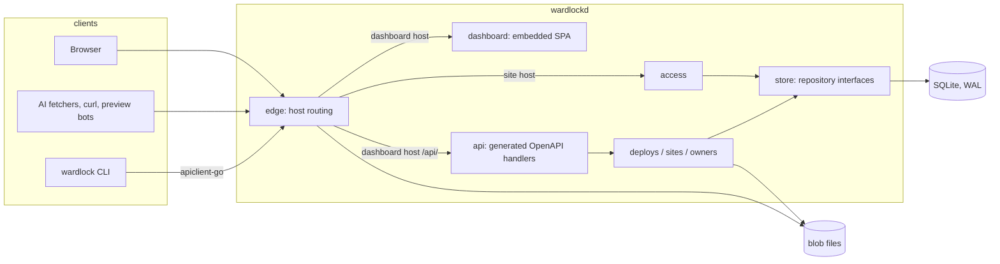
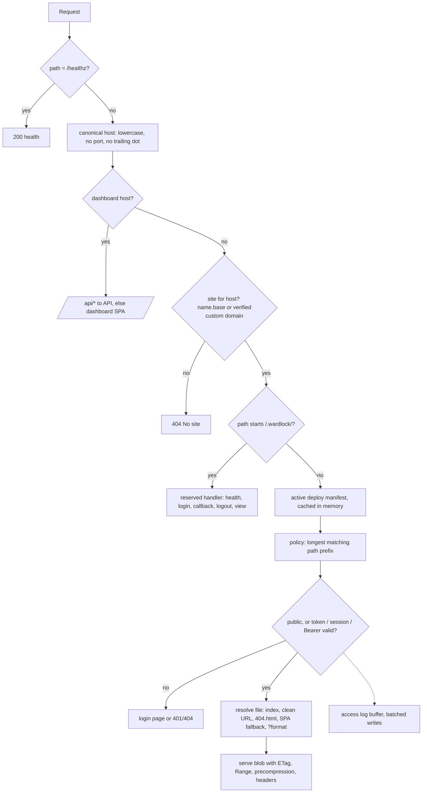
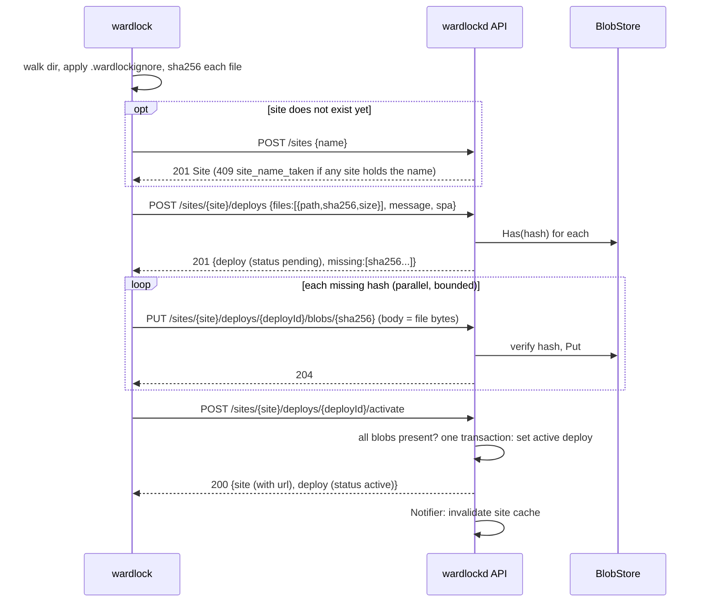
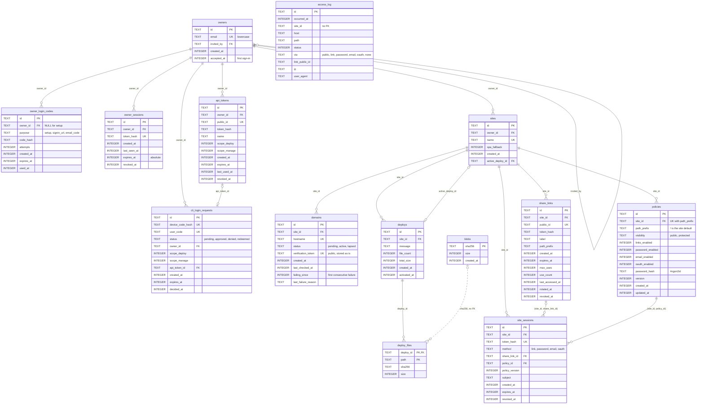
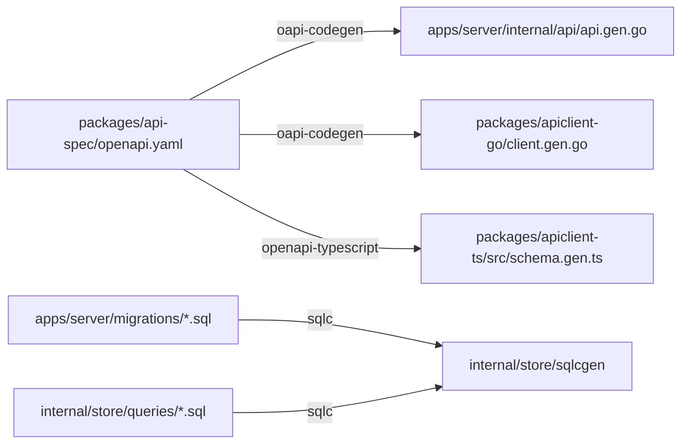

# Architecture

Wardlock is one Go process, `wardlockd`, with an embedded dashboard and a SQLite database, plus a Go CLI that talks to it over the HTTP API. This document records the decisions later items build on. Sections marked with a roadmap ID describe planned behaviour; the rest is built.



## Processes and binaries

- `wardlockd serve` runs everything: the edge on `WARDLOCK_HTTP_ADDR` (and `WARDLOCK_HTTPS_ADDR` from C1.4), the owner API and the dashboard. Configuration is environment variables only (`.env.example` lists every one).
- `wardlock` (CLI) is a separate Go module with no server code; it uses `wardlock.nz/apiclient`.
- `cmd/wardlockd/serve.go` is the only place that wires packages together. It mounts the API under `/api/` on the dashboard host and hands the edge the resulting `http.Handler`, so the edge never imports the API.

## Request flow through the edge



F0.1 implements health, host routing, the dashboard, the built-in hello site and `/.wardlock/health`. The hello site is embedded in `internal/edge/hello` and is removed when C1.3 serves real deploys. The edge's manifest and policy caches are invalidated through a `Notifier` (in-process in v1).

## Deploy upload protocol (C1.2)

The operations are in `packages/api-spec/openapi.yaml` (tag `deploys`); paths below are relative to `/api/v0`.



The server verifies each uploaded blob's SHA-256 before storing it (`400 hash_mismatch`) and accepts only hashes in that deploy's manifest (`400 unexpected_blob`); re-uploading a blob it already holds succeeds, so retries are safe. Activation rejects a deploy with blobs still missing (`409 blobs_missing`) and is a single transaction that moves the site's `active_deploy_id`. Rollback (`POST /sites/{site}/rollback {deployId?}`) is the same transaction pointed at an earlier activated deploy, the previous one by default, with no upload. Path and limit violations are rejected when the deploy is created (`400 invalid_path` naming the path, `413 limit_exceeded`). Renditions (A2.6) are generated between upload completion and activation and stored as blobs referenced from the manifest.

## Storage layout

```text
$WARDLOCK_DATA_DIR/
  wardlock.db (+ -wal, -shm)   SQLite: all metadata
  blobs/sha256/ab/cdef…        content-addressed file bodies (C1.2)
  certs/                       certmagic storage (C1.4)
```

Blobs are written to a temporary file in the same directory, fsynced, then renamed into place, so a blob either exists completely or not at all. Garbage collection (C1.8) removes blobs no deploy references, after a grace period that covers uploads in progress.

## Database

- SQLite through `modernc.org/sqlite` (pure Go, no CGO, so cross-compiling stays trivial). WAL mode, `foreign_keys=ON`, `busy_timeout=5000`, `synchronous=NORMAL`, transactions begin `IMMEDIATE`.
- **Migrations:** a minimal in-house runner (`internal/store/migrate.go`) applies embedded `apps/server/migrations/NNNN_name.sql` files in order, each in one transaction, recording them in `schema_migrations`. Forward only; files are never edited after merge. Versions must be contiguous. The server refuses to start against a database newer than itself (`ErrDatabaseNewer`). We chose this over goose because the requirement is small (plain ordered SQL), it adds no dependency, and it keeps the SQL identical for a future Postgres runner. Revisit if we need down migrations or Go-coded migrations.
- **Queries:** `sqlc` generates typed Go from `internal/store/queries/*.sql` into `internal/store/sqlcgen` (committed). Queries use `sqlc.arg(name)` parameters. There is no ORM.
- **Repository interfaces:** `store` declares one interface per area (`Owners`, `Sessions`, `APITokens`, `Sites`, `Domains`, `Deploys`, `Policies`, `Links`, `AccessLog`; F0.3 onwards) and implements them with sqlc. Domain packages accept the interfaces only; depguard forbids `database/sql` and `sqlcgen` there. Each interface has a contract test suite run against SQLite through `storetest.New`.

### Data model (F0.3)

Migration `0002_core_schema.sql` creates every table below. `internal/store/schema_test.go` checks that this diagram lists exactly the schema's tables, columns, types, primary keys and foreign keys, so update both together. Solid lines are foreign keys; the dotted line is a reference by value with no foreign key.



Columns follow the portable-SQL rules: text IDs (UUIDv7, `store.NewID`) generated in Go, timestamps as UTC Unix milliseconds in `INTEGER` (Postgres `BIGINT`), booleans as `INTEGER` with `CHECK (x IN (0, 1))`, upserts with `ON CONFLICT … DO UPDATE` (or `DO NOTHING`). Token, session and code columns hold only HMAC hashes, and the policy password only an Argon2id hash; the domain verification token is stored as is because it is published in DNS. `access_log` has no foreign keys, so it can later move to a separate store and outlive the sites it mentions. A site session's link and policy are composite foreign keys `(site_id, share_link_id)` and `(site_id, policy_id)` onto `UNIQUE (site_id, id)` in `share_links` and `policies`, so a session can never name another site's link or policy. Deleting a site cascades to its domains, deploys and their manifests, policies, share links and site sessions; the active deploy cannot be deleted on its own.

Names chosen for C1.1: one-time owner credentials live in `owner_login_codes` (`purpose` is `setup` for the first-start setup URL with no owner, `signin_url` for the `admin create` or invite sign-in URL, `email_code` for the 6-digit code). An invite is an `owners` row with `invited_by` set and `accepted_at` NULL plus a `signin_url` code; `accepted_at` is set on first sign-in. CLI login (C1.7) is `cli_login_requests`: the CLI polls with a hashed device code and the API token is minted only when an approved request is redeemed.

**Contract tests.** `storetest.RunContract(t, open)` runs one suite per repository interface; each case gets a fresh database from `open`. SQLite runs it in `internal/store/contract_test.go`; a future backend passes its own opener. Every new repository method adds cases to its interface's suite in `internal/store/storetest/<area>_contract.go`. F0.3 implements only the methods those suites need to exercise the constraints; feature items add the rest in their own `queries/<area>.sql`.

### Storage seam

Wardlock scales up on one machine first: the edge caches manifests in memory, deploys are rare writes, and SQLite in WAL mode handles that easily. Running several server instances would need Postgres, shared blob storage (S3), shared certificate storage and shared rate-limit state, so the seam covers all four:

| Concern            | Interface                                    | v1 implementation      | Later                                     |
| ------------------ | -------------------------------------------- | ---------------------- | ----------------------------------------- |
| Metadata           | `store.Sites`, `Deploys`, `Links`, …         | SQLite + sqlc          | Postgres, passing the same contract tests |
| File bodies        | `BlobStore` (`Has`, `Put`, `Open`, `Delete`) | filesystem             | S3-compatible                             |
| Certificates       | certmagic `Storage` from config              | certmagic file storage | shared storage                            |
| Rate limits        | `Limiter`                                    | in-memory              | shared store                              |
| Cache invalidation | `Notifier`                                   | in-process             | Postgres `LISTEN/NOTIFY` or similar       |

Access-log writes are the only per-request writes. They go into an in-memory buffer flushed in batches (every second or 500 entries) off the request path, so serving never waits on the database; a full buffer drops entries and counts the drops rather than blocking. A Postgres driver, S3 client and multi-instance coordination are out of scope for v1.

## TLS modes (C1.4)

| Mode           | When                                           | Behaviour                                                                                                                                                                                                                             |
| -------------- | ---------------------------------------------- | ------------------------------------------------------------------------------------------------------------------------------------------------------------------------------------------------------------------------------------- |
| Automatic      | Public server with ports 80/443                | certmagic obtains a wildcard `*.<base domain>` certificate through DNS-01 (Cloudflare first, then one more `libdns` provider) plus dashboard and auth hosts; on-demand TLS for verified custom domains only. HTTP redirects to HTTPS. |
| Behind a proxy | Caddy, nginx or a load balancer terminates TLS | Plain HTTP only; trusts `X-Forwarded-*` from configured proxy addresses. The proxy asks `/.wardlock/tls-ask` before issuing a custom-domain certificate (C1.9).                                                                       |
| Local          | `*.localhost` development                      | Plain HTTP. Browsers treat `http://*.localhost` as a secure context, so `Secure` and `__Host-` cookies still work.                                                                                                                    |

F0.1 runs the local mode only.

## Auth origin (A2.5)

OAuth and OIDC providers cannot register wildcard redirect URIs, so every provider redirect goes to `https://auth.<base domain>/callback/<provider>`, served by the edge. It validates `state` and PKCE, checks the allowlist, then creates a single-use, 60-second code bound to the target site and path and redirects to `https://<site>/.wardlock/callback?code=…`. The edge on the site host exchanges the code server-side and sets the host-only site cookie. No cookie is ever set on the base domain.

## Owner API and code generation



- The OpenAPI 3.1 document is the single source of truth. The server implements oapi-codegen's strict interface (`internal/api`); the CLI uses the generated Go client; the dashboard uses `openapi-fetch` typed by `openapi-typescript`. All API paths sit under `/api/v0/` on the dashboard host. The document's description records the conventions every operation follows: the `Error` body (`code`, `message`, optional `target`) and its status codes, the `sessionCookie` and `apiToken` (scopes `deploy`, `manage`) security schemes, UUIDv7 text IDs, Unix-millisecond timestamps, and cursor pagination (`limit`, `cursor`, `{items, nextCursor}`).
- Every operation in the contract is routed from the start. `Server` embeds the generated `Unimplemented` stub (`unimplemented.gen.go`, rendered from `internal/api/templates/`), so an operation answers `501 not_implemented` until its handler lands; a test generated from the same contract proves each one answers 501 rather than 404. The dashboard and CLI expose an operation only once it is built.
- `pnpm codegen` (`scripts/codegen.sh`) regenerates everything and prepends SPDX headers. `pnpm check:codegen` regenerates and fails if any generated file changed, which is how CI catches hand edits and forgotten regeneration.
- Tool versions are pinned in `tools/go.mod` (sqlc, oapi-codegen, golangci-lint, govulncheck) and built into `.local/bin` on first use; `openapi-typescript` and Redocly CLI are pinned in `packages/api-spec/package.json`. `pnpm check:api-spec` lints the contract with Redocly's `recommended-strict` rules plus the rules in `packages/api-spec/lint.redocly.yaml` (every operation has an `operationId`, a 4xx and a default error response, and every body an example).
- The dashboard is built by Vite to `apps/web/dist`, copied by `scripts/embed-dashboard.sh` into `apps/server/internal/dashboard/ui/dist` (gitignored) and embedded with `go:embed`. A server built without it serves `ui/fallback.html`. In `pnpm dev` the server proxies dashboard pages to Vite instead.

## Go workspace

`go.work` lists `apps/server`, `apps/cli` and `packages/apiclient-go` and pins the toolchain (`go1.27.2`). Module paths are vanity paths on `wardlock.nz`. Because that domain does not yet serve `go-import` metadata, the server and CLI `go.mod` files `replace wardlock.nz/apiclient => ../../packages/apiclient-go`: `go.work` covers workspace builds, and the `replace` covers `GOWORK=off` builds and `go mod tidy`. (A `replace` in `go.work` itself is rejected by Go for a module the workspace also uses.) `tools/` is deliberately outside the workspace so linter dependencies never affect product builds.

## Checks

`pnpm check` runs, in order: ESLint and Prettier; the OpenAPI lint (`pnpm check:api-spec`); TypeScript typecheck; Vitest; the Turbo build and `scripts/build-go.sh`; `scripts/check-boundaries.mjs` (SPDX headers, package licences, MIT modules not requiring the server); the codegen drift check; then `scripts/check-go.sh` for each workspace module (gofmt, `go vet`, golangci-lint with depguard boundaries, `go test -race`, govulncheck). Go runs from a script rather than through Turborepo because Go's own build and test caches already make reruns cheap, and wrapping each module in a `package.json` would duplicate them. `pnpm browser:test` runs separately because it needs a browser.
